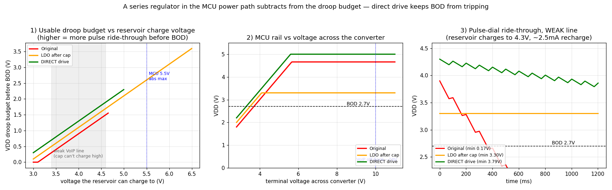

# Pulse-to-Tone Converter — rev V2 (low-loop-current supply)

A redesign of the power front-end of the BRD170127 pulse-to-tone converter to
work reliably on **IP/VoIP phone systems that supply low loop current and low
line voltage**, where the original is marginal. Same board form factor and the
same DTMF/ATtiny signal section; only the supply and the (now passive) filter
change, plus the firmware fixes the project's own history already proved out.

Builds on the upstream development history (LieBtrau / Christoph Tack,
[Hackaday 28557](https://hackaday.io/project/28557-pulse-to-tone-converter)) and
the [engineering analysis](../ANALYSIS.md).

> **Design note / correction.** An earlier draft of this folder put a **series
> LDO between the reservoir cap and the MCU**. That is wrong for this job: during
> a pulse gap the cap droops and the only requirement is **VDD > BOD**; any
> series element (an LDO's dropout, or the original's series diode) is **lost
> headroom that makes BOD trip sooner**, worst exactly on the low-voltage lines
> we care about. The corrected design drives the **MCU directly from the
> reservoir** — see below and the simulation.

> **Scope.** This folder has the **circuit design, BOM, form factor and a full
> supply simulation** — not a routed PCB (no KiCad/EasyEDA here). See
> [§6](#6-what-is-and-isnt-here-and-how-to-finish-the-pcb).

---

## 1. Why the original struggles on IP phone systems

Original front-end: BAT46WH **bridge** → **TLV431 shunt** sets VCC ≈ 4.66 V →
**series Schottky D5** → VDD ≈ 4.25 V → ATtiny85 + an **MCP6022 active filter**.
On a low-current / low-voltage FXS port:

- **A shunt that *sets the rail* needs the loop to supply more current than the
  load.** With the MCP6022 alone drawing ~2 mA continuously, a VoIP port
  current-limited to ~20 mA can have nothing left for the shunt to hold the rail.
- **The series diode D5 cannot regulate** and **costs droop budget**: during each
  rotary pulse the loop is open ~70 ms of every 100 ms, the reservoir discharges,
  and VDD = Vcap − 0.4 V tracks it down. Upstream measured the rail sagging to
  **3.08 V** (active) and the board running "in bursts or not at all" on a VoIP
  FXS with BOD disabled.

## 2. The corrected approach: shunt clamp + **direct drive** (no series reg)

The converter is a **2-terminal device in series with the loop**, so the SLIC/ATA
pushes the full loop current through it while the electronics want only a few mA.
Two facts set the topology:

1. **A shunt is unavoidable** — something must absorb the loop current the
   electronics don't use and clamp ringing. (A *series* LDO can't; the excess
   current has nowhere to go.)
2. **Nothing should sit in series between the reservoir and the MCU.** The ATtiny
   runs from 1.8–5.5 V, so during the droop it doesn't need a regulated rail — it
   only needs to stay above its **2.7 V BOD**. Every series drop (LDO dropout,
   diode) is subtracted from the usable droop and trips BOD sooner.

```
  line ─► BAT46WH bridge ─► [ SHUNT CLAMP ~5.0V ] ──┬──► 680µF ──┬──► VDD ──► ATtiny85V
          (D1..D4)          absorbs excess loop      │           │        + passive RC
                            current; clamps ringing;  (reservoir sits      DTMF filter
                            sets the MCU-safe max      directly on VDD —
                            charge voltage             no series element)
```

- **Shunt clamp ≈ 5.0 V** (safely under the ATtiny's 5.5 V abs max) — a **TL431 +
  small NPN/MOSFET** (or a 5.1 V zener + NPN). It (a) absorbs excess loop current,
  (b) clamps ringing/surge, and (c) sets how high the reservoir charges, which is
  the ride-through energy store. Its exact setpoint is **not critical** (the MCU
  tolerates a wide rail), so bias the reference **well above its minimum operating
  current** and the TLV431 "same batch, some fail" sensitivity disappears.
- **Reservoir 680 µF directly on VDD.** The MCU droops straight from ~5.0 V toward
  BOD with **nothing lossy in the path** — the full charge is usable.
- **Passive RC DTMF filter** replaces the MCP6022 — removes the ~2 mA always-on
  draw (Joris van Rantwijk's 2024 VoIP fix). This is the biggest single current
  saving and is what makes low-loop-current operation possible.
- **ATtiny 2.7 V BOD enabled + idle-sleep during dialing** (Timer0 wake) — the
  upstream-chosen startup/brown-out fix, kept. Tones are generated during the
  steady off-hook (loop closed, rail full), not during the pulse gaps, so a
  drooping-but-alive rail during dialing is fine.

### What about a clean rail for DTMF amplitude?

DTMF is transmitted during the continuous off-hook, when the loop is closed and
the rail is sitting at the ~5 V clamp — stable enough, and the amplitude is set
by the filter/divider scaling (tune per the upstream notes: R10→100 k, R12→15 k
for level). If a tighter amplitude is ever needed it belongs on a **small
reference branch**, never as a series regulator in the MCU supply path.

## 3. Simulation — ride-through as loop current and line voltage fall

`sim/supply_sim.py` (numpy, first-order models) compares the **original**, the
**LDO-after-cap** (the rejected idea), and **direct drive**. The hard metric is
how far the reservoir can droop before VDD hits the 2.7 V BOD.



**BOD-trip cap voltage** (lower is better — a series drop raises it):

| Topology | Trips BOD when Vcap = | Why |
|---|---|---|
| Original (series Schottky D5) | **3.10 V** | loses 0.40 V to the diode |
| LDO after cap | **2.90 V** | loses 0.20 V to LDO dropout |
| **Direct drive** | **2.70 V** | nothing in series — full charge usable |

**Weak-line transient** (reservoir charges to only 4.3 V, ~2.5 mA recharge — a
low-current VoIP port, dialing "0"):

| Topology | min VDD | margin over BOD |
|---|---|---|
| Original | **0.17 V (collapses)** | −2.53 V ✗ |
| LDO after cap | 3.30 V | +0.60 V |
| **Direct drive** | **3.79 V** | **+1.09 V** ✓ |

Reading the panels:
1. **Budget vs charge voltage** — at any given reservoir voltage (the shaded weak
   VoIP region), direct drive has the most droop budget; the LDO and the original
   each give away their series drop. The LDO line only reaches higher budgets by
   charging the cap above 5 V, which needs a strong line that isn't the problem.
2. **Rail vs line voltage** — direct drive gives the highest rail and works down
   to the lowest terminal voltage (no dropout subtracted).
3. **Weak-line ride-through** — direct drive holds 3.79 V while the original
   collapses through BOD; the LDO sits in between.

Behavioural models (no `ngspice` here), so treat the numbers as the comparison
and margins, not lab values; the physics (shunt-needs-excess-current, series-drop-
costs-budget, MCU-tolerates-wide-rail) is what drives the result. Re-run with your
measured ATtiny current / FXS numbers:

```sh
cd hardware_v2/sim && python3 supply_sim.py
```

## 4. Bill of materials — changed/added parts

| Ref | Part | Note |
|---|---|---|
| D1–D4 | BAT46WH (SOD-123) | Schottky bridge — unchanged |
| U_shunt | TL431A + MMBT3904 (or 5.1 V zener + MMBT3904) | **new** shunt clamp ~5.0 V |
| R_bias | ~2.2 k (clamp→ref) | guarantees TL431 bias ≫ I_min (removes batch sensitivity) |
| C1 | **680 µF** electrolytic | reservoir, **directly on VDD** |
| C_dec | 100 nF + 1 µF | MCU decoupling |
| U4 (MCP6022) | **removed** | replaced by passive RC DTMF filter |
| R/C filter | passive RC (DTMF-band low-pass + AC couple) | **new** |
| U1 | ATtiny85V-10SU | unchanged; **enable 2.7 V BOD**, keep external 8 MHz |
| ~~U_ldo~~ | ~~MCP1702~~ | **not used** — no series regulator in the MCU path |

The shunt transistor dissipates up to ~`Vclamp × (I_loop,max − I_load)` ≈ 5.0 V ×
~35 mA ≈ **0.18 W** at the high end — size it and keep copper under it.

## 5. Form factor (preserved)

From the rev-R2 Gerbers (`../Gerber_BRD170127_R2.zip`):
**49.0 mm × 34.0 mm**, 2-layer, three **RJ11 (6P6C)** jacks on the left edge (to
rotary phone / to DTMF phone / to FXS) with their 0.8 mm mounting-pin clusters at
X≈5.3–7.8 mm, Y≈6–11 mm and Y≈22–27 mm. Keep those footprints/positions fixed.
The new supply parts (one SOT-23 ref, a small transistor, a few passives, the
680 µF) replace the removed MCP6022 and the TLV431/divider cluster and fit the
same area.

## 6. What is (and isn't) here, and how to finish the PCB

**Here:** circuit design + rationale, BOM deltas, preserved form factor, runnable
simulation. **Not here:** a routed board / Gerbers — laying out copper needs an
EDA tool (KiCad/EasyEDA) not available in this environment, and hand-writing
Gerbers would be unverifiable.

**To finish it:** open the original **EasyEDA** project, swap the supply section
per §2/§4, and re-route the small changed area (signal section and connectors
stay put); or recreate in **KiCad** — I can generate a KiCad **schematic** and a
49×34 mm **outline** with the RJ11 footprints placed for you to route. Either way,
**validate on a real VoIP FXS** at low loop current — the sim predicts the
margins, the bench confirms them.
