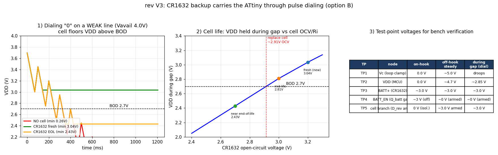

# Pulse-to-Tone Converter — rev V3 (CR1632 coin-cell backup)

Adds a small **CR1632 coin cell that carries the ATtiny through pulse dialing**
(option B), so ride-through no longer depends on the loop at all. This solves the
weak-VoIP brown-out outright: on a low-current / low-voltage FXS the loop can't
refill the reservoir between the ~70 ms pulse gaps, so the MCU walks down through
its BOD and drops digits. With the cell as backup, VDD is **floored at the cell
voltage** through the whole dial.

Builds on [rev V2 (direct-drive supply)](../hardware_v2/README.md) — the shunt
clamp, passive DTMF filter, 2.7 V BOD and idle-sleep all still apply; V3 adds the
coin-cell backup on top.

> **Scope:** circuit, schematic, firmware control, BOM/holder spec, and a full
> simulation with bench test points. **Not** a routed PCB (no KiCad/EasyEDA
> here) — see [rev V2 §6](../hardware_v2/README.md).

## How it works (option B)

Schematic: **[`schematic.svg`](schematic.svg)**.

```
 loop ─► bridge ─► shunt clamp ─┬──[ D_loop ]──────────────┬─► VDD ─► ATtiny
         (BAT46WH)   (~5.0V)     │                          │       + passive filter
                                 │   CR1632(+) ─[Q_batt]─[D_rev]─┘
                                 │               P-MOS   reverse-
                                 │               switch  charge block
                                 └─ C_vc 100µF              │
                                                      BATT_EN (MCU GPIO)
```

- **Q_batt** — a **low-leakage P-MOS switch** between the cell and VDD, driven by
  the MCU's `BATT_EN` pin (active-LOW via a pull-up to BATT+). The MCU **arms** it
  off-hook and must **actively disarm** it on-hook (see below); once disarmed the
  pull-up holds Q_batt **OFF** and the cell draws **~0**, so cell life is
  **shelf-life-limited (~10 yr)**.
- **D_rev** — a low-Vf Schottky (PMEG) in series with the cell, giving the
  **reverse-charge protection** you asked for: it blocks any current *into* the
  primary cell (the ~5 V loop rail can never charge it).
- **D_loop** — isolates the loop rail from VDD during a gap, so the cell powers
  only the MCU, not the loop front-end.
- Because D_loop and D_rev **OR** into VDD, the cell automatically sources current
  **only during the loop-open gaps** (between pulses the loop holds VDD above the
  cell and D_rev is reverse-biased). Arming the cell for the whole off-hook period
  therefore costs essentially nothing — the hardware does the gating.

### Battery & holder (through-hole, off-board)

- **Cell:** CR1632 — 3 V lithium, ~120 mAh, 16 mm × 3.2 mm.
- **Holder:** an **off-board CR1632 holder with flying wire leads** (search eBay
  for *"CR1632 battery holder wire leads"* — the type with a red/black lead pair,
  not a PCB-mount holder). This keeps the bulky holder out of the 49 × 34 mm
  board; only **two THT pads** are needed: **BATT+ (red)** and **BATT− (black)**.
- Mount the holder in the enclosure; route the two leads to the board pads.

## Firmware control

See **[`battery_control.ino`](../firmware/src/battery_control.ino)** — it drops
into the original sketch, now included at [`../firmware/`](../firmware) (the only
source change beyond it is a one-line `rd.lineIsOpen()` accessor in
`rotarydialer.h`). Summary:

- `setup()` → after the normal init, call `batterySetup()`: set `BATT_EN` output,
  default **HIGH (cell off)**, then **arm the cell** (`BATT_EN` LOW) now that we're
  up on loop power (off-hook).
- During dialing, **idle-sleep** between the 1 ms timer wakes so the cell sees
  ~1 mA in the gaps.
- When a digit/number completes, generate **DTMF on loop power** (loop closed,
  steady — the ~4 mA tone current does *not* come from the cell).
- **On-hook detection (software-only, reuses the existing sense).** Once the cell
  is armed it holds VDD up through every loop-open, so **hanging up does not
  remove power** — the MCU must detect on-hook itself. It does so on the **same
  loop/pulse-sense pin** the dial decoder already uses (`rd.lineIsOpen()`): a
  rotary pulse holds the loop open only ~60–100 ms, but a hang-up holds it open
  indefinitely, while between pulses/digits the loop is closed. So the firmware
  times the **sustained** loop-open and, past **~250 ms** (well beyond the longest
  break, and above a ~100 ms hook-flash), calls `cellRelease()` → Q_batt off → VDD
  collapses → MCU powers down. No extra hardware — just this threshold.
- Optional `coinCellLow()` ADC check flags a tired cell (replace below ~2.9 V OCV).

## Simulation & bench verification

`sim/battery_backup_sim.py` models the dialing transient, the cell across its
life, and prints the test-point voltages.



**Dialing "0" on a weak line (4.0 V available):**

| | min VDD during dial | vs 2.7 V BOD |
|---|---|---|
| no cell | **0.26 V (collapses)** | ✗ drops digits |
| CR1632 fresh | **3.04 V** | +0.34 V ✓ |
| CR1632 mid-life | 2.81 V | +0.11 V ✓ |
| CR1632 near EOL | 2.43 V | ✗ → **replace cell** |

The cell floors VDD above BOD while healthy; the replace threshold is **~2.9 V
open-circuit** (where rising internal resistance means it can no longer hold BOD
under the gap load). **Drain ≈ 2 µAh per 10-digit number**, on-hook ≈ 0, so life
is shelf-life-limited.

**Test points** (measure with a meter; scope TP2 while dialing):

| TP | node | on-hook | off-hook steady | during gap (dialing) |
|---|---|---|---|---|
| **TP1** | Vc (loop clamp) | 0 V | ~5.0 V | droops |
| **TP2** | VDD (MCU) | 0 V | ~4.7 V | **~2.85 V** (must stay > 2.7 V) |
| **TP3** | BATT+ (CR1632) | ~3.0 V | ~3.0 V | ~3.0 V (replace < ~2.9 V) |
| **TP4** | BATT_EN (Q_batt gate) | **~3 V (off)** | **~0 V (armed)** | **~0 V (armed)** |
| **TP5** | cell branch (D_rev anode) | 0 V (isolated) | ~3.0 V (armed) | ~3.0 V |

(The MCU arms the cell for the whole off-hook period — TP4 ~0 V — and disarms it
~250 ms after hang-up — TP4 back to ~3 V.)

Bench check: off-hook, confirm **TP2 ≈ 4.7 V** and **TP4 ≈ 0 V** once dialing
starts; scope **TP2** during a dialed "0" — it should **ride the gaps at ~2.85 V,
never below 2.7 V**. Pull the cell and repeat on a weak line: TP2 should now sag
toward BOD and digits drop — proving the cell is doing the work.

**On-hook check (critical for cell life):** hang up and watch **TP4** — it must
return to **~3 V (Q_batt off)** within ~250 ms, and **TP5 → 0 V** (cell isolated).
If TP4 stays at ~0 V on-hook, the loop sense isn't reflecting the hook switch and
the cell will drain in days — fix the sense/threshold before shipping. Verify the
sense also goes open on the hook switch, not only the dial contacts.

Behavioural models (no `ngspice`); treat the numbers as margins. Re-run:

```sh
cd hardware_v3/sim && python3 battery_backup_sim.py
```

## BOM — added parts (on top of rev V2)

| Ref | Part | Note |
|---|---|---|
| BT1 | CR1632 + off-board holder with wire leads | 2 THT pads (BATT+/BATT−) |
| Q_batt | P-channel MOSFET (e.g. DMG2301, logic-level, low R_DS) | low-leakage cell switch |
| D_rev | PMEG2005 (or BAT46) low-Vf Schottky | reverse-charge protection |
| D_loop | BAT46WH Schottky | loop-path OR / isolation |
| R_pu | 1 M | Q_batt gate pull-up to BATT+ (default off) |
| C_dec | 100 µF | VDD decoupling / switchover glitch |
| (R-divider) | 2× R + ADC | optional low-battery sense |

> If the mid-life margin (+0.11 V) is too thin for comfort, replace the series
> `D_rev` with a **P-FET ideal-diode reverse block** (no diode drop) — that
> recovers ~0.15 V and raises the whole curve, at the cost of one more active
> part. The simulation uses the conservative series-Schottky case.
