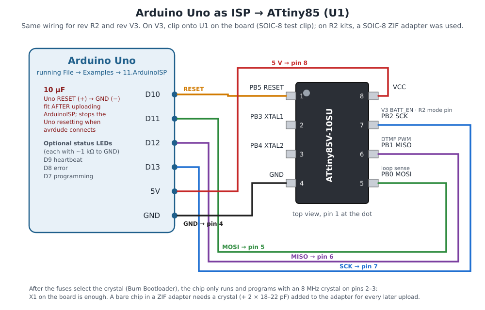

# Rev V3 firmware: source, battery control and the full build process

This is the firmware for **BRD170127 rev V3**. It is kept here, separate from
the R2 firmware (`../../hardware_r2/firmware`), because V3 uses PB2 for the
coin-cell switch.

| Path | What it is |
|---|---|
| `pulse-dtmf-converter-v3/` | the Arduino sketch folder; open `pulse-dtmf-converter-v3.ino` |
| `images/pulse-dtmf-converter-v3.hex` | the compiled image: 2,474 bytes of flash, 118 bytes of RAM. SHA-256 `8a2ba28d…58ca63`. |
| `build.sh` | arduino-cli script: `setup`, `build`, `fuses PORT`, `flash PORT` |
| `arduino_isp_wiring.svg` | wiring diagram for an Arduino Uno as ISP |
| `LICENSE` | GPL v3 |

**Status.** It compiles cleanly (`--warnings all`, no warnings) with the
toolchain in §3, and the build is reproducible: rebuilding gives the same
SHA-256. It has **not yet run on a V3 board**; §6 lists the bench checks.

---

## 1. Where the code comes from

The sketch is upstream **[`593e746`](https://github.com/LieBtrau/pulse-dtmf-converter/tree/593e746/Firmware/platformio/src)**
(Christoph Tack, 2023-02-20, GPL v3) with the rev-V3 changes below. The tone
generator, timers and rotary decoder are upstream's files, unchanged except
for one accessor. How this differs from the 2019 firmware on R2 boards is
covered in `../../hardware_r2/firmware/README.md` §4.

| File | Change from `593e746` |
|---|---|
| `pulse-dtmf-converter-v3.ino` | battery control (§2); PB2 no longer read as a mode jumper, the mode is the constant `SEND_MODE`; AVR-only `reducePower()` |
| `pins.h` | `PIN_LOOP_SENSE = 0` (upstream calls it `PIN_DTMF_OUT`, but it was always the pulse *input*); `PIN_BATT_EN = 2` replaces `PIN_MODE_SELECT` |
| `rotarydialer.h` | adds `bool lineIsOpen()`, the debounced loop state (LOW = open) |
| `dtmfgenerator.*`, `rotarydialer.cpp`, `timer.*`, `singletimer.*` | unchanged |

### Settings (constants at the top of the sketch)

| Constant | Value | Meaning |
|---|---|---|
| `SEND_MODE` | `1` | 1 = collect the number, then send it. 0 = send each digit as it is dialed. R2 boards always ran mode 1; see `../../hardware_r2/firmware/README.md` §3. |
| `DTMF_DELAY_AFTER_LAST_DIALED_DIGIT_ms` | `1200` | upstream's 2023 value. **R2 boards wait 3000 ms.** Raise it if you pause between digits, or if a DECT/cordless base needs the whole number. |
| `MAX_NR_OF_DIALED_DIGITS` | `15` | longer numbers are truncated |
| `REVERSE_DIAL_MODE` | `false` | `true` for reverse-numbered dials (New Zealand) |
| `ONHOOK_MS` | `250` | how long the loop must stay open to count as a hang-up |

## 2. Battery (coin-cell) control

### Hardware it drives

BT1 (CR1632) feeds Q3, the DMG2301L P-MOS, then D6 (BAT46WH) into VDD. That
path is ORed with the loop supply, which comes through D5. Q3's gate is
**BATT_EN = PB2 (pin 7)**, and **R18 (1 MΩ)** pulls the gate up to BATT+.
See `../README.md` §2 and the KiCad schematic.

| PB2 state | Q3 | Cell |
|---|---|---|
| **output, LOW** (`cellArm()`) | on (Vgs about −3 V) | connected to VDD through D6. It only supplies current if VDD falls below the cell voltage. |
| **input, no pull-up** (`cellRelease()`) | off (R18 holds the gate at BATT+) | isolated; drain about 0.03 µA |
| pin not driven (reset, brown-out, no power) | off | isolated |

"Released" makes the pin a **high-impedance input**; it does not drive it HIGH:
- **Driven HIGH**, the pin would sit at about 4.7 V against BATT+ at 3.2 V and
  push about 1.5 µA *into* the primary cell through R18.
- **As an input**, no current flows through R18 at all.

When armed, R18 has the cell voltage across it, so 3.2 µA flows only while the
phone is off-hook.

### The logic

`updateCell()` runs after every `rd.update()`, roughly every millisecond:

```
loop closed (rd.lineIsOpen() == false):
    remember the time; if the cell is not armed -> cellArm()
loop open and the cell armed:
    if the loop has been open for longer than ONHOOK_MS (250 ms) -> cellRelease()
```

**Why the firmware has to switch the cell off.** Once the cell is armed, it
keeps VDD alive through a hang-up, so the MCU would keep running and slowly
drain the cell. The loop sense (PB0) is the only clue to the hook state. It
reads LOW whenever the loop is open: during a dial break, a hook-flash, or a
hang-up. The 250 ms threshold separates them.

### Every situation

| Situation | Loop sense on PB0 | What the firmware does |
|---|---|---|
| Lift the handset | VCC rises and the MCU starts from reset. `setup()` releases the cell, then the first loop pass sees the loop closed. | **arms** within a few ms |
| Dialing: about 60 ms breaks, 10 pps | open less than 250 ms each time | stays armed. SPICE shows the cell supplies nothing here (C1 holds VDD above 4.4 V). |
| Hook-flash (about 100 ms) | open less than 250 ms | stays armed. Note: like R2, the decoder also counts a flash as the digit "1". |
| Hang up | open for good | **releases** 250 ms later. With the loop open and the cell off, VDD runs down and the MCU stops. |
| Lift again before VDD has died (C1 keeps the MCU alive for a few hundred ms) | closed again | **re-arms** at once |
| Hang up while a number is being sent (mode 1) | the check is paused by the blocking `delay()`s while tones play | releases as soon as sending ends: at most about 2.4 s for 15 digits, about 1 mA from the cell |
| Incoming ring while on-hook | the ring current powers the MCU and the sense toggles at 20–25 Hz | arms during each ring burst, releases 250 ms into each silent gap. VDD stays above the cell during the ring, so the cell is idle (SPICE). |
| VDD falls below the BOD threshold | — | brown-out reset, so PB2 becomes an input and the cell is **released by hardware** (R18) |
| **Cell parts not fitted** (BT1, Q3, D6, R18) | as above | PB2 drives nothing. **The converter works exactly the same**, with nothing else to change. |

**The one failure that matters:** if PB0 did not see the hang-up, the cell
would stay armed. The MCU would then run from it at about 0.9 mA, emptying a
CR1632 in **about 5 days** (SPICE). That's why check 2 in §6 must be done on
the first board.

## 3. Tools

| Tool | Version used | Notes |
|---|---|---|
| **Arduino IDE 2.x**, *or* **arduino-cli** | arduino-cli 1.2.2 (Ubuntu 26.04 package `arduino-cli`) | the IDE route and the command-line route use the same board package |
| **ATTinyCore** (Spence Konde) | **1.5.2** | Boards Manager URL `http://drazzy.com/package_drazzy.com_index.json` |
| **Bounce2** (Thomas Fredericks) | **2.71** | Library Manager: "Bounce2" |
| avr-gcc | 7.3.0-atmel3.6.1-arduino7 | installed **with** the board package; Ubuntu's `gcc-avr` is not used |
| avrdude | 6.3.0-arduino18 | installed with the board package; it does the actual programming |
| Programmer | **Arduino Uno running ArduinoISP** (as for R2), or any ISP that ATTinyCore lists (USBasp, AVRISP mkII, Atmel-ICE…) | an XGecu/TL866 can also write the `.hex` plus fuses to a bare chip |

**How this compares with R2:**

| | R2 (2020–21) | V3 |
|---|---|---|
| IDE | Arduino IDE 1.8.13 | IDE 2.x or arduino-cli |
| ATTinyCore | 1.4.1 | 1.5.2 |
| Bounce2 | 2.55 | 2.71 |
| ISP hardware | Arduino Uno as ISP | the same: **yes, the same Uno setup works** |

**Watch out:** ATTinyCore 1.5.2's **defaults are wrong for this board**. The
clock defaults to *8 MHz internal* and the B.O.D. to *disabled*. Both must be
changed (§4), or the tones come out at the wrong pitch and there is no
brown-out reset.

## 4. Board settings and fuses

**Arduino IDE:** add the Boards Manager URL under File → Preferences, install
"ATTinyCore", install "Bounce2" from the Library Manager, then set the Tools
menu:

| Tools menu item | Setting |
|---|---|
| Board | ATTinyCore → **ATtiny25/45/85 (No bootloader)** |
| Chip | **ATtiny85** |
| Clock Source (only set on bootload) | **8 MHz (external)** |
| B.O.D. Level (only set on bootload) | **B.O.D. Enabled (2.7v)** |
| Save EEPROM (only set on bootload) | EEPROM retained |
| Timer 1 Clock | CPU (CPU frequency) |
| LTO | Enabled |
| millis()/micros() | Enabled |
| Programmer | **Arduino as ISP** |

**arduino-cli** uses the same choices as one board name (FQBN). It is in
`build.sh`:

```
ATTinyCore:avr:attinyx5:chip=85,clock=8external,TimerClockSource=default,LTO=enable,millis=enabled,eesave=aenable,bod=2v7
```

### Fuses

The clock, start-up time and brown-out level live in the ATtiny's **fuses**,
not in the program. They are written only by **Tools → Burn Bootloader**
(arduino-cli `burn-bootloader`). This board has no bootloader: the command
erases the chip, writes the fuses and an empty program. The values are
**identical to R2's**:

| Fuse | Value | Bits that matter |
|---|---|---|
| Low | **0xFF** | CKSEL = 1111 + CKSEL0/SUT = 1/11: an **external crystal of 8 MHz or more**, with start-up for a slowly rising supply (16K clocks + 64 ms, which suits the slow ramp through C1 470 µF); CKDIV8 off, so the CPU runs at 8 MHz; no clock output |
| High | **0xD5** (0b1101 0101) | **BODLEVEL = 101 → brown-out at 2.7 V**; EESAVE = 0 (EEPROM kept on erase); SPIEN = 0 (ISP enabled); RSTDISBL = 1 (the RESET pin stays a reset, so ISP keeps working); DWEN = 1, WDTON = 1 |
| Extended | **0xFF** | SELFPRGEN off |
| Lock | 0xFF | no lock |

### The brown-out ("drop-out") voltage

The brown-out detector holds the ATtiny in reset whenever VDD is below the
**BODLEVEL** threshold. It is set **only by the high fuse**, so pick it in the
B.O.D. menu and burn the fuses again to change it; code cannot change it.

| B.O.D. menu | High fuse | Threshold (datasheet min / typ / max) | Use |
|---|---|---|---|
| Disabled | 0xD7 | — | **don't**: no clean reset during the slow power-up through C1 (the problem upstream hit on VoIP lines) |
| 1.8 V | 0xD6 | 1.7 / 1.8 / 2.0 V | too low for 8 MHz |
| **2.7 V** | **0xD5** | **2.5 / 2.7 / 2.9 V** | **use this one.** The ATtiny85V is only rated for 8 MHz at 2.7 V or more (speed grade: 10 MHz at 2.7–5.5 V), so 2.7 V is the lowest safe trip point. |
| 4.3 V | 0xD4 | 4.1 / 4.3 / 4.5 V | too high: V3's VDD runs at about 4.5–4.7 V and would trip it while dialing |

On V3, VDD sits at about 4.67 V and SPICE shows it stays at 4.4 V or more
while dialing, so the 2.7 V detector only acts at power-up and power-down. A
brown-out also **releases the coin cell** (PB2 floats, R18 turns Q3 off).

```sh
# the same fuses with avrdude directly (Arduino as ISP = stk500v1 at 19200 baud):
avrdude -c stk500v1 -P /dev/ttyACM0 -b 19200 -p attiny85 -e \
        -U lfuse:w:0xFF:m -U hfuse:w:0xD5:m -U efuse:w:0xFF:m
# read them back:
avrdude -c stk500v1 -P /dev/ttyACM0 -b 19200 -p attiny85 \
        -U lfuse:r:-:h -U hfuse:r:-:h -U efuse:r:-:h
```

## 5. Programming a V3 board

### The Arduino Uno as ISP (the same setup as R2)



| Uno | ATtiny85 (U1) | Function | V3 net on that pin |
|---|---|---|---|
| D10 | pin 1 (PB5) | RESET | RESET (R11 10k pull-up) |
| D11 | pin 5 (PB0) | MOSI | loop sense (R14 10k) |
| D12 | pin 6 (PB1) | MISO | DTMF PWM (R12 10k) |
| D13 | pin 7 (PB2) | SCK | BATT_EN (Q3 gate, R18 1M) |
| 5V | pin 8 | VCC | VDD |
| GND | pin 4 | GND | GND |
| 10 µF from the Uno's RESET (+) to GND (−) | — | stops the Uno resetting when avrdude opens the port | — |

**Can the R2 setup be reused? Yes.** It is the same chip, with the same pins
and fuses.
- **R2:** the chip was programmed **out of circuit**, in a SOIC-8 ZIF adapter.
- **V3:** program it **in circuit** with a SOIC-8 test clip on U1, or out of
  circuit as before.

Nothing on the V3 board fights the ISP lines:
- the series 10 kΩ resistors on MOSI and MISO, and the 1 MΩ/Q3 gate on SCK,
  are light loads;
- the crystal X1 is already fitted.

For in-circuit programming:
- **Unplug the phone line and remove the coin cell.** With the cell fitted it
  is harmless: D6 blocks the Uno's 5 V from charging it, and SCK just toggles
  Q3. Removing it is simply tidier.
- The Uno's 5 V also charges **C1 (470 µF)**. If the Uno resets when the clip
  goes on, fit the clip first and plug the Uno's USB in afterwards.

### Step by step (Arduino IDE)

1. **Make the Uno a programmer:**
   - select Board = Arduino Uno and its port;
   - open File → Examples → 11.ArduinoISP → ArduinoISP and upload it;
   - then fit the 10 µF capacitor.
2. **Wire** the Uno to U1 as above.
3. **Select the ATtiny settings** in §4: board, chip, 8 MHz external, BOD 2.7 V,
   programmer *Arduino as ISP*, and the Uno's port.
4. **Tools → Burn Bootloader.** This writes the fuses (L 0xFF, H 0xD5,
   E 0xFF). Do it **once per chip**.
   - A new ATtiny85 runs at 1 MHz from its internal oscillator, so this first
     step works without the crystal.
   - From then on the chip **needs the 8 MHz crystal** (X1) to run *and* to be
     programmed.
   - A bare chip in a ZIF adapter therefore needs a crystal (+ 2 × 18–22 pF)
     added to the adapter for every later upload.
5. Open `pulse-dtmf-converter-v3/pulse-dtmf-converter-v3.ino` and run
   **Sketch → Upload Using Programmer** (Ctrl+Shift+U).

### Step by step (command line)

```sh
cd hardware_v3/firmware
./build.sh setup                 # once: ATTinyCore 1.5.2 + Bounce2 2.71 into ~/.arduino15
./build.sh fuses /dev/ttyACM0    # once per chip (= Burn Bootloader)
./build.sh flash /dev/ttyACM0    # compile + write + verify the flash
```

These run (arduino-cli `--dry-run` output, 2026-11-19):

```
avrdude -C…/ATTinyCore/hardware/avr/1.5.2/avrdude.conf -pattiny85 -cstk500v1 -P/dev/ttyACM0 -b19200 \
        -e -Uefuse:w:0xFF:m -Uhfuse:w:0b11010101:m -Ulfuse:w:0xFF:m -Uflash:w:…/empty_all.hex:i
avrdude -C…/ATTinyCore/hardware/avr/1.5.2/avrdude.conf -pattiny85 -cstk500v1 -P/dev/ttyACM0 -b19200 \
        -Uflash:w:…/pulse-dtmf-converter-v3.ino.hex:i
```

To program from the prebuilt image without installing the IDE, use avrdude
with `-U flash:w:images/pulse-dtmf-converter-v3.hex:i` (plus the fuse command
in §4).

### XGecu (TL866-style) programmer, for bare chips

Load `images/pulse-dtmf-converter-v3.hex` and set the configuration to
**Low 0xFF, High 0xD5, Extended 0xFF, Lock 0xFF**. This is the same procedure
as the R2 production chips.

## 6. Bench checks on the first board

1. **Tones:** dial a number and decode the DTMF at the line, or listen to it.
   Wrong pitch, or nothing at all, means the clock fuse is wrong.
2. **Cell release:** with a cell fitted, go off-hook and check that TP4
   (BATT_EN) is at about 0 V. Hang up: TP4 must rise to BATT+ (about 3 V)
   **within about 250 ms**, and TP5 (CELL) must fall to about 0 V. If TP4
   stays low on-hook, **remove the cell**: the loop sense is not seeing the
   hang-up.
3. **Fuses:** read them back (§4). They should be **FF / D5 / FF**.
